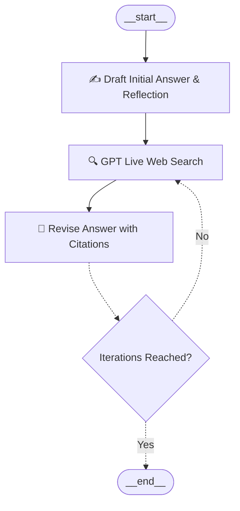

# Verity

Self-correcting research agent. It drafts an answer, critiques what is missing, searches the live web, and revises the answer with citations.

Built with **LangGraph** and OpenAI’s native web search. The loop follows the Reflexion pattern: draft, search, revise, repeat until the iteration limit.

---

## 🏛 Architecture

The agent follows the self-correcting Reflexion loop:



1. **`draft` node** (`chains.py:first_responder`):
   - Answers the user's research query.
   - Critiques its own answer via structured Pydantic schema (`AnswerQuestion.reflection`).
   - Identifies what is missing and recommends 1–3 targeted `search_queries`.

2. **`execute_tools` node** (`tool_executor.py:execute_tools`):
   - Intercepts the generated `search_queries`.
   - Executes live web searches concurrently using the current GPT model's built-in search tool (`tools=[{"type": "web_search"}]`).
   - Wraps the retrieved web findings and URLs into LangChain `ToolMessage`s.

3. **`revise` node** (`chains.py:revisor`):
   - Considers the previous critique and the fresh live web search evidence.
   - Produces a fact-checked, revised answer with numerical citations and exact source references (`ReviseAnswer.references`).

4. **`event_loop`**:
   - Decides whether to trigger another research-revision cycle or terminate at `END`.

---

## 🚀 Getting Started

### 1. Requirements
Ensure your `.env` contains your OpenAI API key:
```env
OPENAI_API_KEY=your_openai_api_key
```

*(Optional environment variables)*:
```env
OPENAI_MODEL=gpt-5-mini
MAX_ITERATIONS=1
```

### 2. Run the Workflow

```bash
uv run python main.py
```

This will:
- Display both the **Mermaid** and **ASCII** workflow graph.
- Save the graphical diagram to **`graph.png`**.
- Execute the full Reflexion research loop and display the initial draft, search queries, revised answer, citations, and reflection critique.
